# Ambuscade

Traps and defences for holding a base, on Fabric and NeoForge. Every trap knows who placed it and leaves you and your team alone. Built for multiplayer: codes and lists never leave the server.

## Sentry

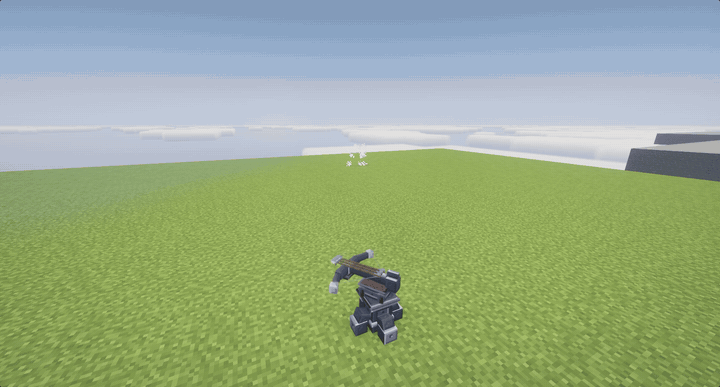

A crossbow turret that patrols its arc and turns to face what it shoots. It loads vanilla arrows, takes them from hoppers and holds fire on a redstone signal.

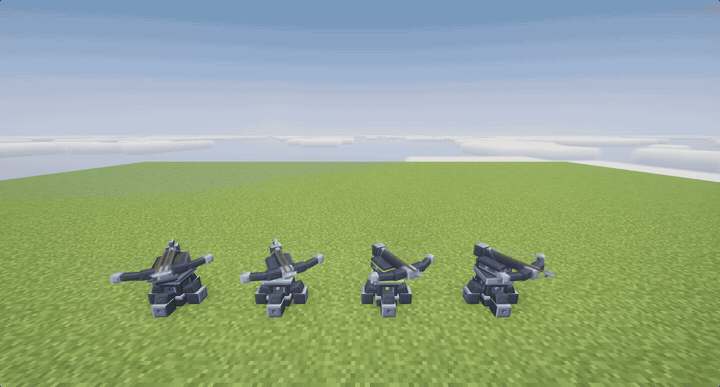

Four tiers, upgraded with a module: iron, gold, diamond and netherite, from 8 to 24 blocks of reach and longer bursts. The endless module gives it infinite ammo.

## Mortar

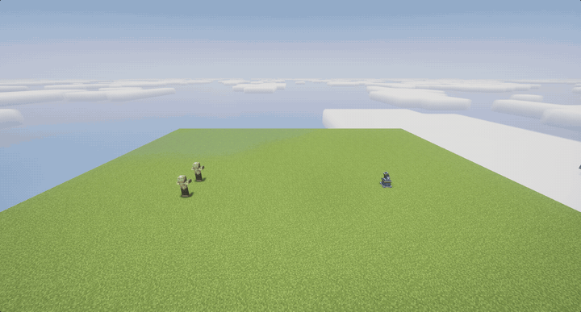

Fires over walls, 2 to 96 blocks. Mark a spot with a fire order, hand it to the mortar, then fire with redstone. A ring shows where the shell lands. Long shots keep their chunks loaded and scatter wider with distance.

Sentry and mortar are heavy: you carry one at a time.

## Bear trap

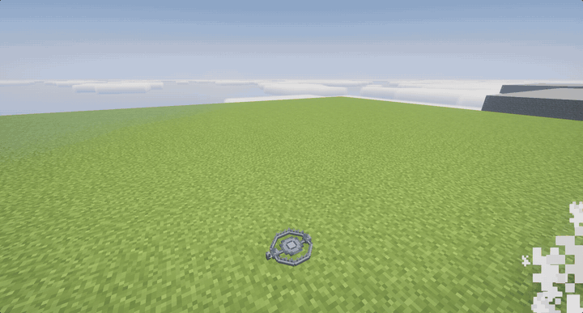

Snaps shut on whoever steps in and holds them. Right-click to re-arm.

## Mines

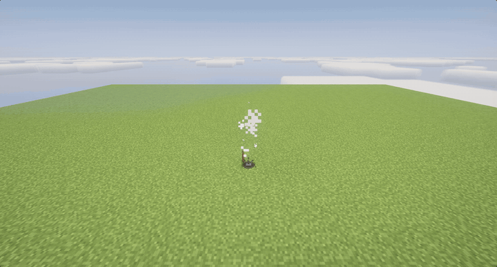
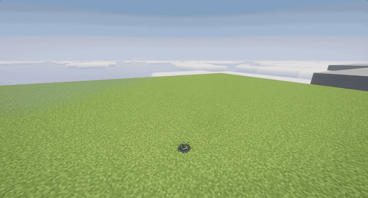
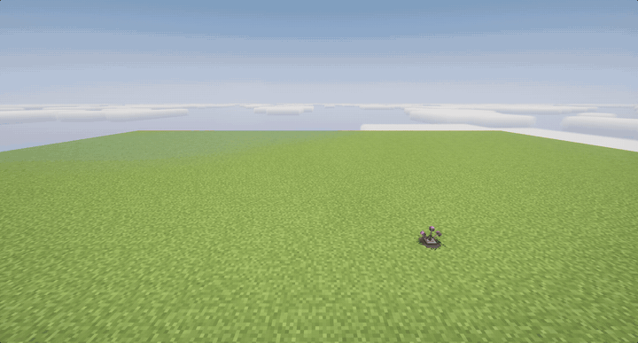

Explosive, gas (a poison cloud, one use) and teleport, which sends the victim to the spot you placed it from.

## Barbed wire

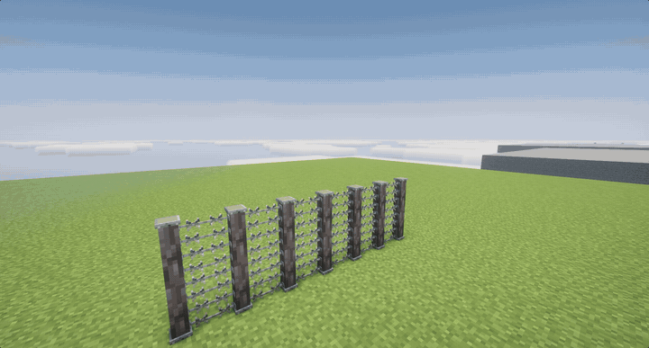

Joins into long runs and stacks into walls. Slows whatever pushes through and cuts it on every step, through armour. One for every wood. Right-click a straight run to remove or add its post.

## Camouflage net

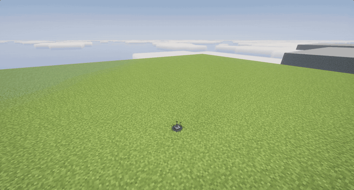

Hides a mine or bear trap under a copy of the ground. The trap still works.

## Keypad lock

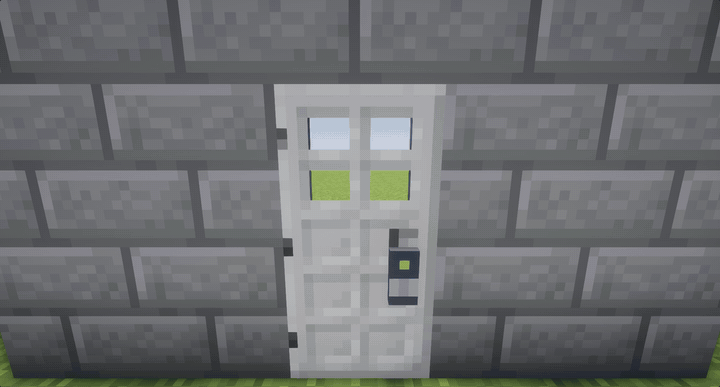
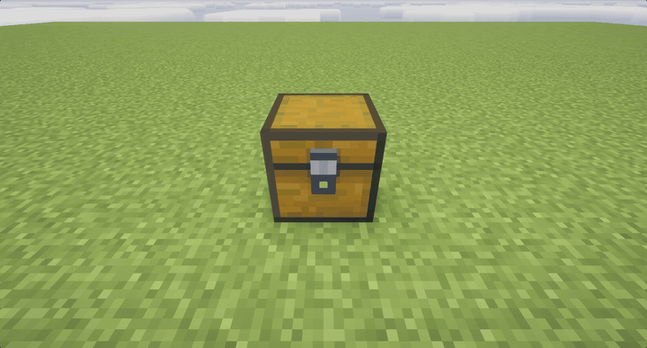

Turns any vanilla door, or a chest, into one that opens only with a code. Type it with the mouse or the number keys. Redstone, pistons, hoppers and mobs get nothing. Only the owner can break it, and gets the door or chest back with the lock. Three wrong codes lock it out, longer each time.

## Perimeter ledger

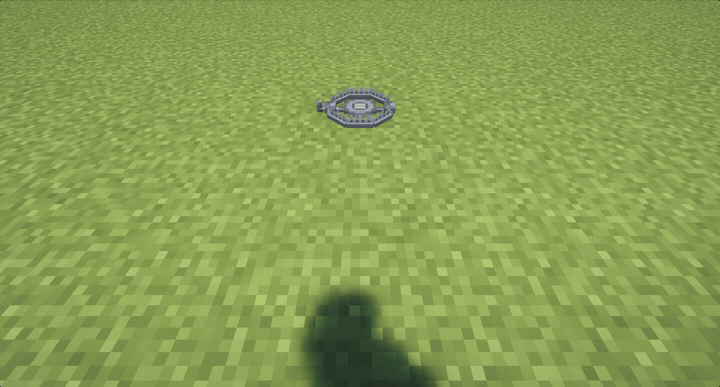

Choose who your traps spare, or who they go after: players by name, pets, farm animals, villagers and monsters. Right-click a trap with the ledger to link it. Without a ledger, a trap spares whoever placed it and their team.

## Servers

`config/ambuscade.properties` sets the mortar's longest shot (`mortar.max_range`, 8 to 96).

## Requirements

- Minecraft 1.21.1, Fabric Loader or NeoForge
- [Architectury API](https://modrinth.com/mod/architectury-api)
- [GeckoLib](https://modrinth.com/mod/geckolib)
- [Fabric API](https://modrinth.com/mod/fabric-api) (Fabric only)

## Download

[Modrinth](https://modrinth.com/mod/ambuscade) (link pending). See [CHANGELOG.md](CHANGELOG.md) for what each version adds, and [RELEASING.md](RELEASING.md) to publish one.

## License

All Rights Reserved. See [LICENSE](LICENSE).
