# Ambuscade

Traps and base defence for Minecraft, on Fabric and NeoForge.

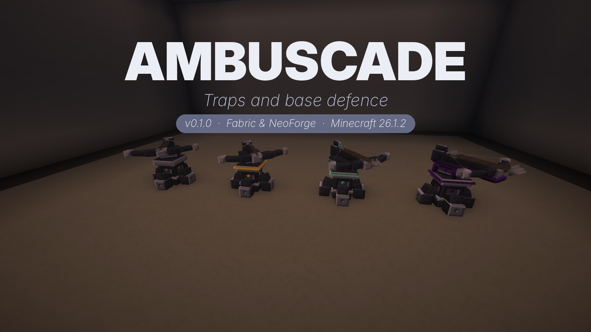

## Features

- **Barbed wire**: slows and hurts whatever pushes through it.
- **Bear trap**: snaps shut on whoever steps in and holds them in place.
- **Landmines**: explosive, gas and teleport mines.
- **Sentry turret**: a crossbow sentry in four tiers (iron, gold, diamond, netherite) that loads vanilla arrows.
- **Mortar**: indirect fire, aimed with a fire order and fired with redstone.
- **Camouflage net**: hides mines and bear traps.
- **Keypad lock**: locks vanilla doors and chests behind a code.
- **Perimeter ledger**: decides who your traps spare and who they hit.

## Gallery

| | |
|---|---|
| 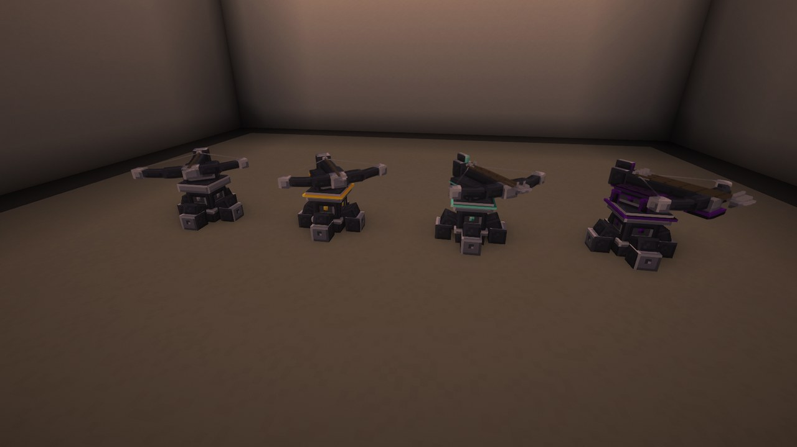 | 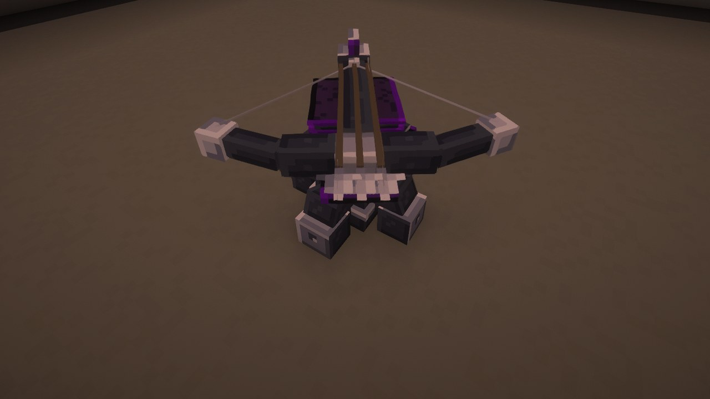 |
| 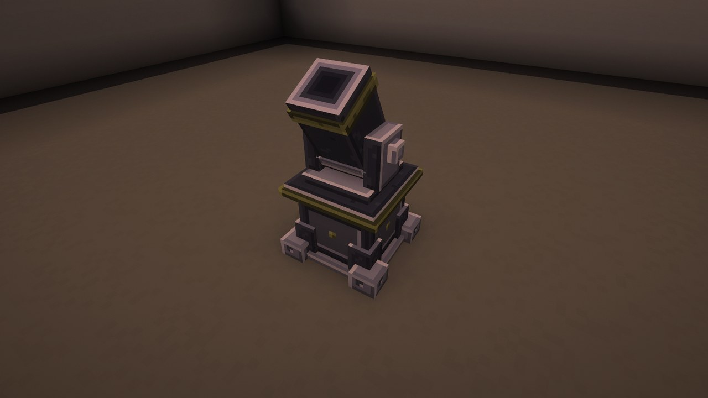 | 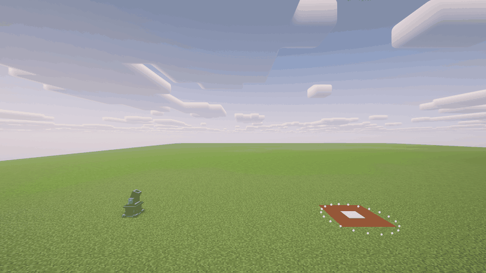 |
| 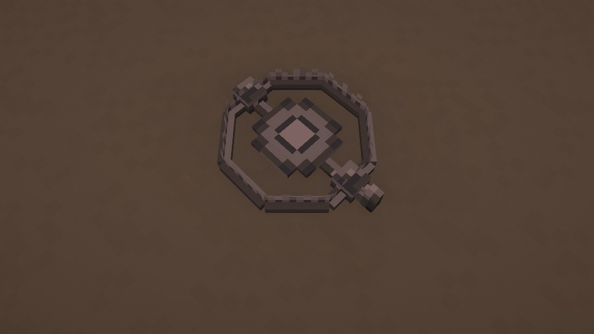 | 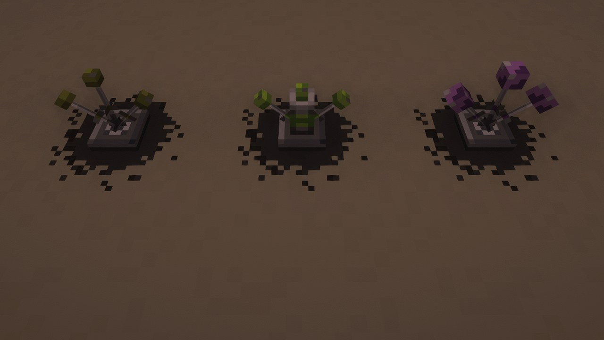 |
| 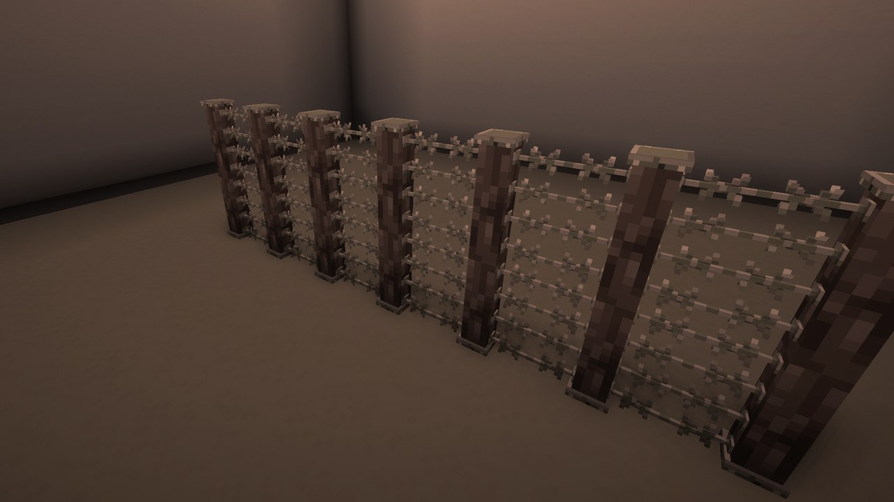 | 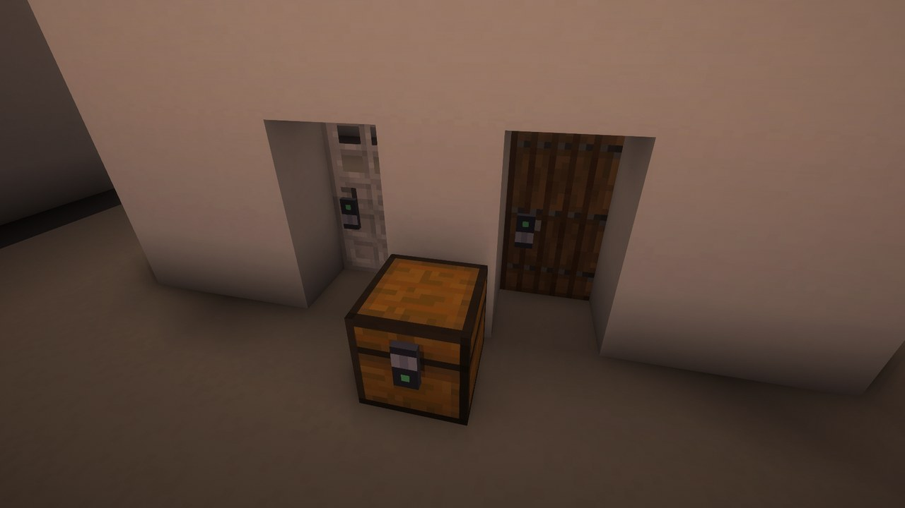 |
| 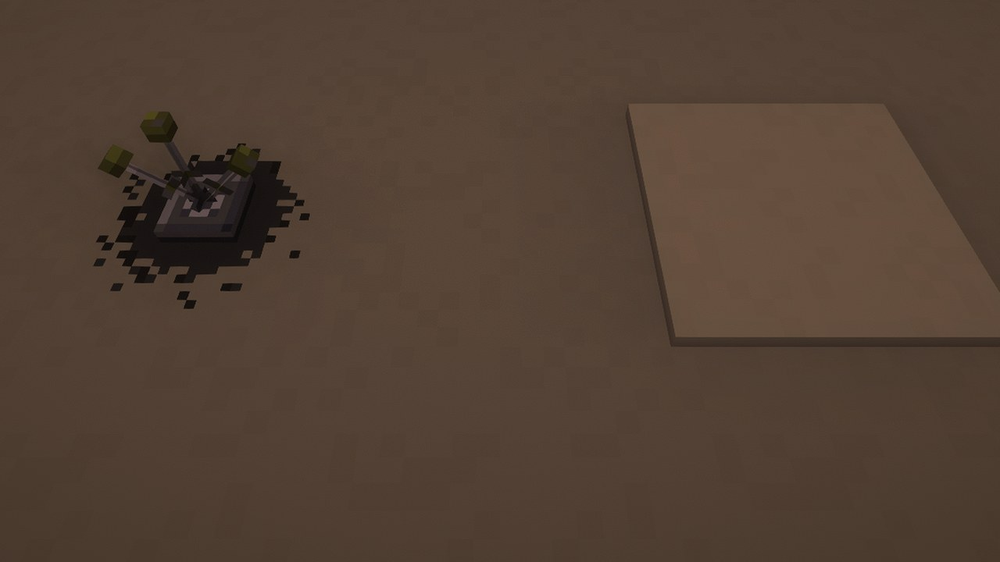 | 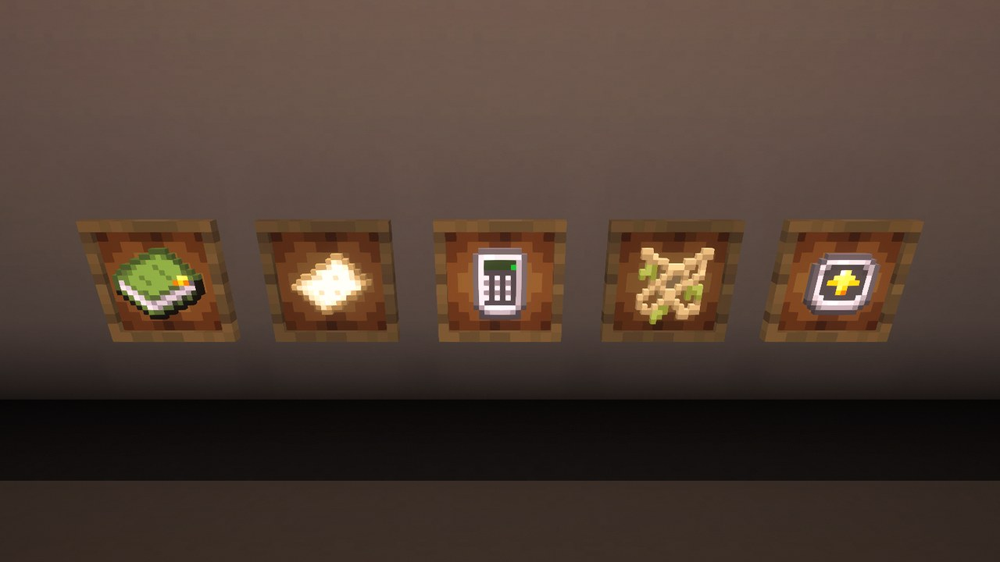 |

## Requirements

- Minecraft 26.1.2
- Fabric Loader or NeoForge
- [Architectury API](https://modrinth.com/mod/architectury-api)
- [GeckoLib](https://modrinth.com/mod/geckolib)
- [Fabric API](https://modrinth.com/mod/fabric-api) (Fabric only)

## Download

[Modrinth](https://modrinth.com/mod/ambuscade) (link pending). See [CHANGELOG.md](CHANGELOG.md) for what each version adds.

## Releasing

Add a `## <version>` section to `CHANGELOG.md`, then push a tag:

```
git tag v0.1.0-mc26.1.2 && git push origin v0.1.0-mc26.1.2
```

The tag is `v<mod_version>-mc<minecraft_version>`, matching `gradle.properties`. A `-alpha.N` or `-beta.N`
suffix on the version (`v0.2.0-beta.1-mc26.1.2`) publishes as alpha or beta. The release workflow needs
a Modrinth token and the project id:

```
gh secret set MODRINTH_TOKEN --repo valentin-marquez/ambuscade
gh variable set MODRINTH_PROJECT_ID --repo valentin-marquez/ambuscade --body <project id or slug>
```

## License

All Rights Reserved. See [LICENSE](LICENSE).
